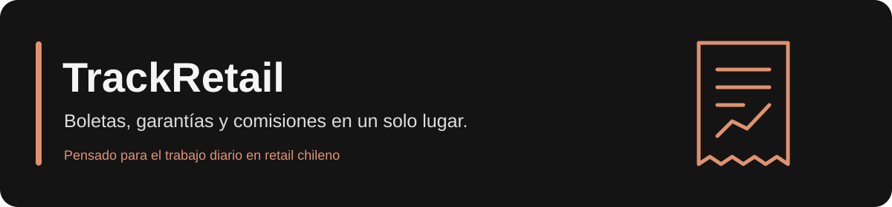
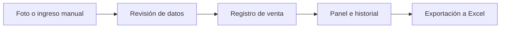

# TrackRetail

**De la boleta al seguimiento de tus comisiones.**

Una aplicación web para registrar ventas de garantías, consultar tu rendimiento y organizar el trabajo diario en retail chileno. Dentro de la aplicación también encontrarás el nombre **BryanApp**.

[**Abrir la aplicación**](https://pinwin-mu.vercel.app) · [Guía de uso](docs/GUIA_DE_USO.md) · [Instalación](docs/CONFIGURACION.md) · [Reportar un problema](https://github.com/mashmellows172-cmd/track-retail/issues/new/choose)

> **Estado: en desarrollo.** Consulta el [PR #1](https://github.com/mashmellows172-cmd/track-retail/pull/1) para conocer el estado de las mejoras de funcionamiento, seguridad y adaptación a dispositivos. Una rama de GitHub y la aplicación desplegada pueden tener versiones distintas.

## ¿Qué puedes hacer?

| Función | Para qué sirve |
| --- | --- |
| Escanear una boleta | Tomar una foto o subir un archivo para extraer sus datos con IA. |
| Registrar manualmente | Ingresar o corregir los datos antes de confirmar una venta. |
| Consultar el panel | Revisar comisiones, garantías, canales de venta y actividad reciente. |
| Definir una meta | Seguir el avance de una meta mensual y explorar proyecciones. |
| Revisar el historial | Filtrar las ventas por mes y año. |
| Exportar a Excel | Descargar los registros del período para revisarlos fuera de la aplicación. |

## Empieza a usarla

1. Abre la [aplicación](https://pinwin-mu.vercel.app) y configura tu nombre.
2. Entra en **Registrar Boleta** o pulsa **+** en el celular.
3. Escanea, sube un archivo o elige el ingreso manual.
4. Revisa folio, fecha, importes, canal y garantía antes de confirmar.
5. Consulta el **Historial** y tu **Panel de Control**.



La IA puede equivocarse al leer una boleta: la revisión del formulario forma parte del registro. Las proyecciones dependen de las reglas configuradas; confirma los tramos con el responsable del negocio.

[Ver la guía completa y preguntas frecuentes →](docs/GUIA_DE_USO.md)

## Instalar en tu equipo

Necesitas **Node.js 22 LTS**, npm, un proyecto de Supabase y una clave de Gemini para usar el escáner.

```sh
git clone https://github.com/mashmellows172-cmd/track-retail.git
cd track-retail
npm ci
```

Antes de arrancar, crea `.env.local` en la raíz:

```dotenv
NEXT_PUBLIC_SUPABASE_URL=https://tu-proyecto.supabase.co
NEXT_PUBLIC_SUPABASE_ANON_KEY=tu-clave-publica
GEMINI_API_KEY=tu-clave-de-servidor
```

Prepara las tablas siguiendo la [guía de configuración](docs/CONFIGURACION.md) y después ejecuta:

```sh
npm run dev
```

Abre [localhost:3000](http://localhost:3000). Para una base existente, revisa y respalda los datos antes de ejecutar SQL: `database.sql` es un esquema inicial, no una migración de actualización.

## Tecnología

- **Next.js y React:** aplicación web y rutas del servidor.
- **TypeScript y Tailwind CSS:** tipos y estilos de la interfaz.
- **Supabase / PostgreSQL:** almacenamiento y cálculo de comisiones.
- **Google Gemini:** lectura automática de boletas.
- **SheetJS:** exportación a Excel.

El código de las páginas está en [`src/app`](src/app), los componentes en [`src/components`](src/components) y el esquema inicial en [`database.sql`](database.sql).

## Datos y conexión

El nombre del vendedor se guarda en el navegador y permite seleccionar sus ventas. **No es una cuenta con contraseña ni garantiza privacidad entre vendedores.**

La aplicación intenta conservar registros pendientes en el dispositivo cuando falla la conexión. No borres los datos del navegador hasta comprobar su sincronización en el historial. Esto no equivale a una copia de seguridad ni garantiza abrir toda la aplicación sin internet.

Nunca publiques credenciales ni boletas con datos personales. Antes de usar datos privados en una instalación pública, revisa los controles de acceso y las políticas RLS de Supabase.

[Consultar seguridad y tratamiento de datos →](SECURITY.md)

## Colabora

¿Encontraste un error o una forma de simplificar el trabajo? Usa las [plantillas de reportes y propuestas](https://github.com/mashmellows172-cmd/track-retail/issues/new/choose). Describe una situación concreta y utiliza datos ficticios.

Para contribuir con código o documentación, consulta [CONTRIBUTING.md](CONTRIBUTING.md).

## Mejoras y evolución

El [PR #1](https://github.com/mashmellows172-cmd/track-retail/pull/1) reúne cambios de sincronización, validaciones, simuladores, accesibilidad y pruebas automáticas. Consulta su estado y el despliegue correspondiente para saber cuáles están disponibles en la aplicación.
